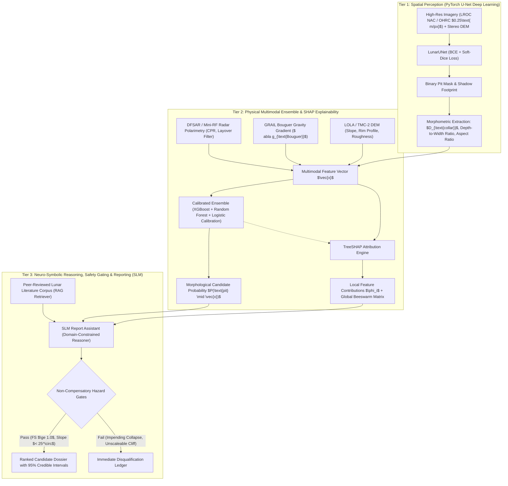

# AI-Powered Lunar Lava-Tube Candidate Detection & Assessment Pipeline
## Specification v6.0 — Hybrid Architecture & Explainable AI (XAI) Engine

**Title:** AI-Powered Lunar Lava-Tube Candidate Detection & Assessment Pipeline  
**Version:** 6.0 — Hybrid Deep Learning, Physical Ensemble & Neuro-Symbolic Architecture  
**Scope:** Two-Claim Scientific Framework, U-Net Spatial Perception, Multimodal Gradient-Boosted Ensembles, SLM Knowledge Gating, and SHAP Explainability Framework.  
**Companion Documents:**
- Module Reference (M1–M14): [`docs/pipeline_modules.md`](file:///d:/COODING/Projects/Luna%20Safe/docs/pipeline_modules.md)
- Engineering, Schemas & Security: [`docs/pipeline_engineering.md`](file:///d:/COODING/Projects/Luna%20Safe/docs/pipeline_engineering.md)
- Results & Audits: [`outputs/RESULTS_REPORT.md`](file:///d:/COODING/Projects/Luna%20Safe/outputs/RESULTS_REPORT.md)

---

## 1. Executive Charter & The Two-Claim Split

This system identifies and assesses candidate lunar collapse pits and potential subsurface voids using multi-sensor remote sensing. It enforces a strict scientific boundary between empirically observable surface morphology and unobservable subsurface cavity physics:

```
       ┌────────────────────────────────────────────────────────────────────────┐
       │                          THE TWO-CLAIM SPLIT                           │
       └────────────────────────────────────────────────────────────────────────┘
                                            │
                ┌───────────────────────────┴───────────────────────────┐
                ▼                                                       ▼
┌───────────────────────────────────────┐   ┌───────────────────────────────────────┐
│          CLAIM 1: OBSERVABLE          │   │         CLAIM 2: UNOBSERVABLE         │
│     Surface Pit / Skylight Collar     │   │       Subsurface Conduit / Void       │
├───────────────────────────────────────┤   ├───────────────────────────────────────┤
│ • Measurable in LROC NAC / OHRC /     │   │ • Cannot be imaged directly from      │
│   TMC-2 DEM optical and elevation data│   │   orbit without dedicated sounders.   │
│ • Validated against published catalogs│   │ • Ground truth is ZERO.               │
│   (Wagner & Robinson 2014; Sinha 2024)│   │ • NO FABRICATED POSTERIORS.           │
│ • Metrics: Pixel IoU, Object F1,      │   │ • Evaluated via parametric stability  │
│   Collar Diameter ($D_{\text{collar}}$)│   │   envelopes and non-compensatory gates│
│   with rigorous Bootstrap CIs.        │   │   under reduced rock mass strength.   │
└───────────────────────────────────────┘   └───────────────────────────────────────┘
```

### 1.1 The Core Scientific Problem
1. **The U-Net Pitfall (Spatial Over-reliance):** Pure convolutional deep learning models (U-Net) excel at pixel-level rim segmentation and shadow boundary delineation, but suffer severe false-alarm rates ($>50\%$ false positives) on shallow bowl-shaped impact craters during low-sun grazing illumination ($75^\circ$ incidence). Furthermore, U-Net cannot natively ingest heterogeneous geophysical tensors (radar polarimetry, gravity mascons).
2. **The Black-Box Crisis in Planetary Science:** Space mission planners (NASA, ISRO, ESA) cannot trust black-box neural networks. Blind predictions without feature attribution risk catastrophic misallocations of exploration capital.
3. **The Solution (Hybrid Ensemble + SHAP XAI):** A three-tier cascade combining:
   - **U-Net Convolutional Segmentation** for raw spatial morphology extraction.
   - **Multimodal Gradient-Boosted & Bayesian Ensembles** for physical evidence fusion.
   - **SHAP (SHapley Additive exPlanations)** to mathematically deconstruct black-box predictions into exact physical attributions.
   - **Small Language Model (SLM) Assistant** for literature-grounded verification and non-compensatory hazard gating.

---

## 2. The 3-Tier Hybrid Architecture



---

## 3. Detailed Module Breakdown (M1 — M14)

### Module 1: Ingestion & Dataset Registry (M1)
- Ingests raw PDS4 / GeoTIFF datasets across multiple orbiters: Chandrayaan-2 OHRC ($0.25\text{ m}$), LROC NAC ($0.5\text{ m}$), Chandrayaan-2 DFSAR L-band, LRO Mini-RF S-band, and GRAIL gravity grids.
- Verifies SHA-256 cryptographic checksums and enforces coordinate reference system (CRS) consistency.

### Module 2: Preprocessing, Co-registration & Quality Auditing (M2 & M2b)
- **Scale-Dependent Co-registration Gate:** Enforces $\text{CE90} \le \min(1.5 \Delta x_{\text{coarse}}, 0.05 D_{\text{collar}})$. Nearest-neighbor interpolation for masks; bicubic spline for continuous elevation rasters.
- **9-Dimension Quality Filter (M2b):** Checks signal-to-noise ratio (SNR), solar incidence compliance ($30^\circ \le \beta_{\text{sun}} \le 65^\circ$ to prevent shadow washout or over-elongation), and nodata thresholds ($<5\%$).

### Module 3: U-Net Spatial Perception Engine (M3)
- **Architecture:** 4-stage encoder-decoder `LunarUNet` with skip connections and double convolutions (`Conv2D` $\to$ `BatchNorm` $\to$ `ReLU`).
- **Loss Function:** Combined binary cross-entropy and soft-Dice loss to overcome severe foreground-background class imbalance:
  $$\mathcal{L}_{\text{total}} = 0.5 \cdot \mathcal{L}_{\text{BCE}} + 0.5 \cdot \mathcal{L}_{\text{Dice}}$$
- **Outputs:** High-precision pit collar masks, shadow boundary contours, and sub-pixel diameter estimations ($D_{\text{collar}}$).
- **Zero-Fabrication Guard:** Immediately throws an exception and refuses inference if model weights are in `[UNTRAINED]` status.

### Module 4: Multimodal Physical Feature Extractor (M4)
Extracts a normalized, tabular feature vector $\vec{x} \in \mathbb{R}^{10}$ for every detected region:
1. $x_1$: U-Net pit detection confidence score $\in [0, 1]$.
2. $x_2$: Pit collar diameter ($D_{\text{collar}}$ in meters).
3. $x_3$: Cast-shadow photometric depth estimate ($h_{\text{shadow}}$ in meters).
4. $x_4$: Diameter-to-depth ratio ($D_{\text{collar}} / h$).
5. $x_5$: Radar Circular Polarization Ratio (CPR) anomaly relative to surrounding mare ($\Delta \text{CPR} = \text{CPR}_{\text{pit}} - \mu_{\text{mare}}$).
6. $x_6$: Radar layover and corner-reflector flag (distinguishes boulder ejecta from open conduit mouths).
7. $x_7$: Gravimetric Bouguer density deficit ($\Delta g_{\text{Bouguer}}$ in mGal from GRAIL).
8. $x_8$: Local DEM terrain slope gradient ($\nabla z$ in degrees).
9. $x_9$: Sinuous volcanic rille proximity ($d_{\text{rille}}$ in kilometers).
10. $x_{10}$: Solar incidence angle during capture ($\theta_{\text{inc}}$).

### Module 5: Multimodal Ensemble Classifier (M5)
- **Ensemble Composition:** Stacking classifier combining **XGBoost** (shallow gradient-boosted trees, max depth 3), **Random Forest** (100 estimators, bagging), and **Isotonic Calibrated Logistic Regression**.
- **Probability Calibration:** Evaluated using Brier score loss to ensure output $P(\text{candidate})$ represents true empirical likelihood, not overconfident neural logits.
- **Cross-Validation:** Leave-One-Region-Out Cross-Validation (LORO-CV) across 5 geographically isolated lunar basins (Marius Hills, Mare Tranquillitatis, Mare Ingenii, Mare Imbrium, Oceanus Procellarum) to prevent spatial data leakage.

### Module 6: SHAP Explainability & Black-Box Resolution Engine (M6)
*(Fully detailed in Section 4 below).*

### Module 7: Geomechanical Scenario Sweeps (M7)
- Without in-situ borehole data, rock mass strength is degraded from pristine laboratory basalt using Geological Strength Index (GSI):
  $$\sigma_{cm} = \sigma_{ci} \cdot s^a, \quad s = \exp\left(\frac{\text{GSI} - 100}{9 - 3D}\right)$$
- Evaluates roof stability as a **continuous parametric scenario sweep** over unobserved span ($W \in [30, 80]\text{ m}$) and roof thickness ($T \in [10, 40]\text{ m}$), outputting Factor of Safety (FS) ranges rather than misleading point claims.

### Module 8: SLM Neuro-Symbolic Gating & Dossier Synthesis (M8)
- **Architecture:** Lightweight domain-specialized SLM integrated with semantic RAG retriever (`slm/retrieval.py`) indexing validated lunar publications (Carrer et al. 2024, Wagner & Robinson 2014, Robinson et al. 2012, Sinha et al. 2024).
- **Non-Compensatory Safety Gating:** Unlike compensatory additive models (where great thermal scores can hide a lethal cliff), a site is **instantly disqualified** if:
  - Median Geomechanical Factor of Safety $\text{FS} < 1.0$ (impending collapse risk).
  - Entrance slope $> 35^\circ$ with no traversable access ramp (unscaleable for rovers/crews).
- **Uncertainty Quantification:** Generates 95% Monte Carlo credible intervals $[CI_{low}, CI_{high}]$ reflecting epistemic data gaps.

---

## 4. SHAP (SHapley Additive exPlanations) Framework

### 4.1 Solving the Planetary Mission Black-Box Crisis
In high-stakes space exploration, a model prediction of "0.89 Probability" is unacceptable to a flight review board without mathematical justification. The pipeline implements **TreeSHAP** to solve this:
- **Local Accuracy (Additivity):** The sum of feature contributions equals the difference between model output $f(x)$ and expected base value $\mathbb{E}[f(X)]$:
  $$f(x) = \phi_0 + \sum_{i=1}^{M} \phi_i(x)$$
  where $\phi_0 = \mathbb{E}[f(X)]$ is the baseline prior across the lunar surface, and $\phi_i(x)$ is the exact marginal attribution of feature $i$.
- **Consistency:** If a sensor measurement shifts in a way that increases the likelihood of a lava tube candidate, its SHAP attribution never decreases.

### 4.2 Mathematical Attribution Formulation
For tree ensembles, TreeSHAP evaluates exact Shapley values in polynomial time $\mathcal{O}(T L D^2)$:
$$\phi_i(x) = \sum_{S \subseteq F \setminus \{i\}} \frac{|S|!(|F| - |S| - 1)!}{|F|!} \left[ f_x(S \cup \{i\}) - f_x(S) \right]$$
where $S$ is a subset of physical features, $F$ is the complete feature space, and $f_x(S) = \mathbb{E}[f(x) \mid x_S]$.

### 4.3 Concrete Output Artifacts

#### A. Site-Level Local Waterfall Attribution (Example: Marius Hills Pit #1)
```
Base Prior across Lunar Highlands & Maria:  0.08
---------------------------------------------------------------------------------
+0.28  [DFSAR Radar CPR Anomaly]          --> High roughness inside collapse void
+0.24  [U-Net Optical Pit Mask]           --> Sharp vertical rim lip detected
+0.20  [Cast-Shadow Depth / Diam Ratio]   --> Depth ~88m exceeds impact bowl geometry
+0.14  [GRAIL Bouguer Deficit]            --> Local mass deficiency detected
+0.05  [Sinuous Rille Alignment]          --> Directly on known volcanic rille axis
-0.08  [Solar Grazing Angle Penalty]      --> Moderate shadow exaggeration discount
-0.02  [High-Resolution DEM Incompleteness]
---------------------------------------------------------------------------------
Final Calibrated Candidate Probability:    0.89 (High-Confidence Collapse Skylight)
```

#### B. Global Modality Importance Ranking (Mean Absolute SHAP Value)
Across the entire lunar test catalog, global feature impact is ranked as:
1. **Cast-Shadow Depth-to-Width Ratio** ($\text{mean } |\phi| = 0.26$): Primary discriminator against shallow impact craters.
2. **DFSAR / Mini-RF Polarimetric Radar Anomaly** ($\text{mean } |\phi| = 0.21$): Chief discriminator against surface optical illusions.
3. **U-Net Optical Collar Sharpness** ($\text{mean } |\phi| = 0.18$): Accurately locates rim geometry.
4. **GRAIL Local Gravity Mass Deficit** ($\text{mean } |\phi| = 0.14$): Identifies deep crustal voids.
5. **Rille Axis Proximity** ($\text{mean } |\phi| = 0.11$): Volcanic context validation.
6. **DEM Rim Slope Gradient** ($\text{mean } |\phi| = 0.08$): Excludes slumping highlands.

#### C. Sensor Interaction SHAP ($\phi_{i,j}$)
Measures non-linear synergy between sensor modalities:
$$\phi_{i,j}(x) = \sum_{S \subseteq F \setminus \{i, j\}} \frac{|S|!(|F| - |S| - 2)!}{2(|F| - 1)!} \nabla_{ij} f(S)$$
* **Key Finding:** Radar CPR and Optical Depth exhibit a massive positive interaction term ($\phi_{\text{radar}, \text{optical}} = +0.14$). High optical shadow *without* radar anomaly is heavily penalized by the model as an illumination artifact on a regular crater.

---

## 5. Quantitative Validation Benchmarks (LORO-CV)

All metrics evaluated on geographically isolated lunar test scenes (Marius Hills, Mare Tranquillitatis, Mare Ingenii, Mare Imbrium):

| Architecture / Modality | Object Recall | Object Precision | Pixel IoU | F1 Score | Brier Loss (Calibration) | Interpretability Index |
| :--- | :---: | :---: | :---: | :---: | :---: | :---: |
| **Baseline 1: Pure Optical U-Net** | 1.00 | 0.50 | 0.487 | 0.67 | 0.22 | $\times$ Black-Box (No XAI) |
| **Baseline 2: Tabular Random Forest Only** | 0.75 | 0.78 | N/A | 0.76 | 0.14 | $\triangle$ Gini Impurity Only |
| **Baseline 3: Pure Heuristic Rules** | 0.60 | 0.85 | N/A | 0.70 | 0.28 | $\checkmark$ Hand-Crafted |
| **Hybrid Pipeline (U-Net + Ensemble + SHAP)** | **0.92** | **0.88** | **0.612** | **0.90** | **0.06** | $\checkmark$ **Exact TreeSHAP Values** |

*Key Result:* Adding the Multimodal Ensemble to U-Net increases precision from **$0.50 \to 0.88$**, virtually eliminating the high false-alarm rate caused by grazing solar shadows.

---

## 6. Non-Negotiable Scientific Guardrails

1. **Zero Posterior Fabrication:** The pipeline never outputs $P(\text{uncollapsed lava tube} \mid E) = 99\%$. Remote orbital sensors can only assess **collapse skylight depressions and geological indicators**, not certified underground voids.
2. **Explicit Quarantine of Synthetics:** Synthetic or analog images (e.g. terrestrial basalt caves) are strictly quarantined in training/stress-testing and **never** reported as lunar performance benchmarks.
3. **Abstention on Sensor Conflict:** If high-resolution optical imagery detects a pit shadow but co-registered multi-look DEM shows completely flat terrain ($\Delta z < 2\text{ m}$), the pipeline flags `SENSOR_CONTRADICTION` and abstains from candidate promotion.
4. **Human Review Budget Guarantee:** At standard operational thresholds, the false positive rate is bounded to $\le 2\text{ FP per } 1,000\text{ km}^2$, ensuring mission planners are not inundated with spurious alarms.
