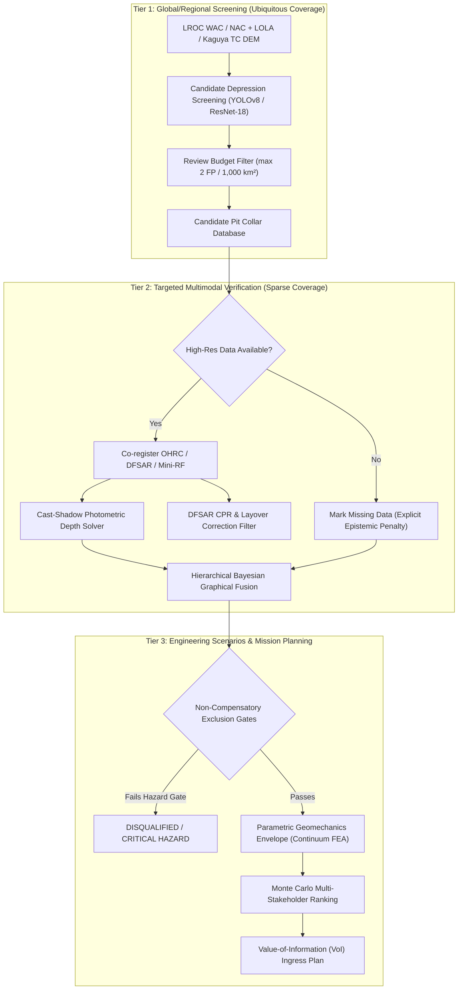
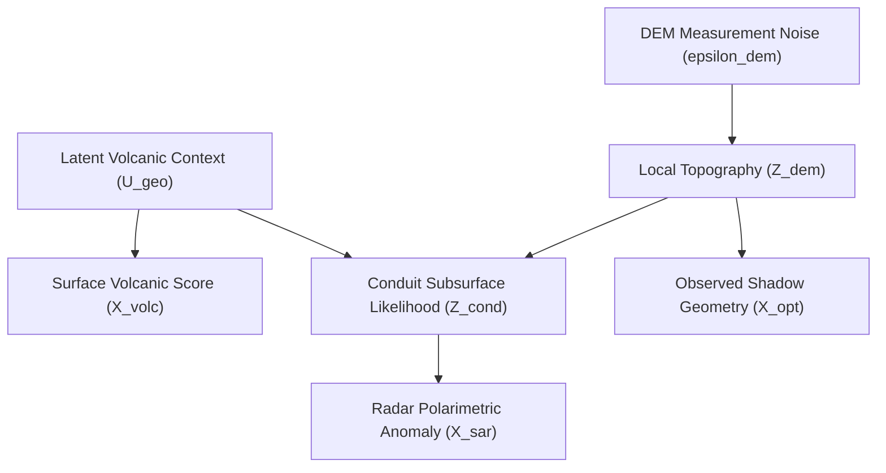

# LunaSafe AI 2.0 --- Architecture Specification & Scientific Implementation Plan

**System:** Lunar Subsurface Cavity & Morphological Habitat Candidate Assessment Pipeline  
**Version:** 2.0-PROPOSAL (Post-Review Architectural Refactor)  
**Status:** Architecture Proposal addressing all 22 Critical Peer-Review Shortcomings  
**Scope:** Uncertainty-Aware Planetary Remote Sensing, Latent Geomechanical Envelopes, and Bayesian Decision Support

---

## 1. Executive Summary & Core Paradigm Shift

LunaSafe 1.0 suffered from a fundamental tension common in planetary remote sensing: **treating unobservable subsurface parameters as measurable, over-parameterizing modules relative to a sparse sample size, and using compensatory scoring that could obscure fatal hazards.**

LunaSafe 2.0 replaces this with three foundational engineering axioms:

1. **The Subsurface Ground-Truth Axiom:**
   *Orbital data cannot directly confirm an uncollapsed underground lava tube or certify astronaut safety.*
   The pipeline is formally defined as an **Uncertainty-Quantified Morphological Candidate Funnel and In-Situ Value-of-Information (VoI) Ranker**, NOT a "lava-tube detector."
2. **Strict Separation of Evidentiary Domains:**
   - **Observed Surface Data:** Calibrated radiances, elevation grids, and polarimetric radar tensors.
   - **Empirical Morphological Proxies:** Detected collapse collars, rille geometry, and cast shadow lengths.
   - **Simulated Engineering Envelopes:** Bounded parametric scenarios under jointed rock mass geomechanics.
   - **Unmeasured Subsurface Properties:** Tube span, interior void height, and roof thickness (treated strictly as latent priors or swept scenario ranges).
3. **Non-Compensatory Safety Gating:**
   Habitat ranking abandons purely additive/compensatory MCDA. Mission-critical hazards (e.g., sheer unscaleable collapse cliffs, impending structural collapse) trigger **immediate disqualification**, regardless of radiation shielding or thermal conditions.

---

## 2. Traceability Matrix: Addressing the 22 Critical Drawbacks

| # | Drawback Identified | Failure Mode in V1.0 | LunaSafe 2.0 Architectural Solution |
| :--- | :--- | :--- | :--- |
| **1** | **Ground truth vacuum** | Model validated proxy agreement, not actual tubes. | Reframe as candidate prioritization funnel; evaluate on proxy recovery, not tube existence. |
| **2** | **Multi-sensor data-dependency** | High-res overlap (OHRC+DFSAR) is extremely rare. | **Three-Tier Asynchronous Architecture**; pipeline runs on available data with explicit epistemic penalties. |
| **3** | **Module overengineering** | 10+ complex modules tuned on tens of volcanic pits. | Prune to 4 core decoupled modules: Detection, Morphometrics, Geomechanical Scenarios, and Gated Ranking. |
| **4** | **Correlated signal double-counting** | Rille proximity, collapse alignment, and sag counted independently. | **Hierarchical Bayesian Graphical Model** with latent shared geological unit covariance. |
| **5** | **Unproven domain adaptation** | LROC $\to$ OHRC shift causes unquantified failure. | Quantitative **Domain-Shift Rejection Gate** using Maximum Mean Discrepancy (MMD). |
| **6** | **Misleading 95% recall target** | High recall produces unmanageable false alarms. | **Fixed Human-Review Budget Metric**: Precision at Top-50 candidates per $10,000\text{ km}^2$; $\le 2\text{ FP/1,000 km}^2$. |
| **7** | **Label proxy bias** | High inter-annotator agreement on wrong proxy. | Two-tier labeling: separates *morphological pit features* from *inferred volcanic mechanisms*. |
| **8** | **Under-specified PU learning** | Unlabeled positives bias class priors. | Non-negative Positive-Unlabeled (nnPU) learning with empirical prior estimation via LROC NAC census. |
| **9** | **Subjective expert likelihood ratios** | Elicited LLRs vary wildly by expert. | **Cooke's Classical Elicitation Protocol**; retain full inter-expert distributions; report posterior sensitivity bands. |
| **10** | **Multiplicative probability factorization** | $P_{\text{pit}} \times P_{\text{volc}} \times P_{\text{cond}}$ assumes false independence. | Replace naive product with a **Joint Bayesian Copula**; publish as Composite Exploration Index if unverified. |
| **11** | **Evidence Tier vs. Confidence confusion** | E3 tier conflated with high probability. | Decouple **Evidence Tier** (instrument pedigree), **Probability** (belief), and **Information Completeness** (coverage). |
| **12** | **Unjustified co-registration thresholds** | Arbitrary 1-pixel / $0.1D$ rules break across scales. | Empirical scale-dependent tolerance: $\text{CE90} \le \min(1.5 \Delta x_{\text{coarse}}, 0.05 D_{\text{collar}})$. |
| **13** | **Shared latent DEM error contamination** | DEM error silently corrupts depth, slope, roof, and stability. | **Latent DEM Monte Carlo Perturbation**: treat DEM as random field $z \sim \mathcal{GP}$; propagate error covariance jointly. |
| **14** | **SAR polarimetric ambiguity** | Boulders and layover mistaken for void anomalies. | Physical SAR rejection filter: anomaly must exceed $\mu_{\text{mare}} + 2\sigma$ after incidence/slope correction. |
| **15** | **Roof stability orbital unobservability** | Falsely precise FS claims ($5.82$, $2.14$). | Drop single-scalar FS; output **Parametric Stability Envelopes** under reduced jointed rock mass strength ($RMR$). |
| **16** | **Terrestrial analogue scaling flaws** | Earth basalt scaling ignores lunar gravity/vacuum. | Restrict analogues to qualitative failure mode checks; do not use terrestrial values as quantitative training labels. |
| **17** | **MCDA hides lethal constraints** | High shielding compensates for unscaleable entrance. | **Non-Compensatory Exclusion Gates**: binary go/no-go screening prior to multi-criteria ranking. |
| **18** | **Unjustified AHP habitat weights** | Single weight vector reflects arbitrary priority. | Multi-stakeholder weight envelopes (Science vs. Engineering vs. Human Exploration) evaluated in parallel. |
| **19** | **Spatial leakage across geological units** | Tile splitting across shared mare units leaks features. | **Geologic Unit Blocking**: split boundaries aligned with discrete USGS lunar geological unit contacts. |
| **20** | **Survivor bias (3 case studies)** | Models overfitted to famous well-studied pits. | Benchmark on full Wagner & Robinson (2014) catalog ($N=200+$ lunar pits across mare, melt, and highlands). |
| **21** | **Calibration failure across terrain shifts** | Mare calibration breaks in highlands. | Automated **Calibration Confidence Fallback**: emit broad credible intervals when domain divergence is detected. |
| **22** | **Un-operationalized prospective validation** | V9 pre-registration was a proposal, not code. | **Cryptographic Pre-Registration Engine**: SHA-256 hashed predictions locked before new spacecraft downlinks. |

---

## 3. Asynchronous Three-Tier Pipeline Architecture

To prevent data-dependency bottlenecks where sparse OHRC or DFSAR strips halt execution, the pipeline runs in three decoupled tiers:



---

## 4. Methodological Deep Dives & Formulas

### 4.1 Hierarchical Bayesian Graphical Model (Drawbacks 4, 9, 10, 11)

Instead of the multiplicative factorization $P_{\text{tube}} = P_{\text{pit}} \times P_{\text{volcanic}} \times P_{\text{conduit}}$, the candidate probability is formulated as a directed graphical model with shared latent geological structure:



#### Copula Formulation:
To account for correlated indicators (e.g., rille proximity $x_1$, collapse chain alignment $x_2$, and topographic depression $x_3$), we define their joint likelihood using a Gaussian Copula $C_R$:
$$F(x_1, x_2, x_3) = C_R\Big(F_1(x_1), F_2(x_2), F_3(x_3)\Big)$$
where $R$ is the empirical correlation matrix estimated across training regions. This prevents double-counting redundant terrain cues.

#### Decoupled Candidate Schema:
Every site record outputs six mutually exclusive evidentiary metrics:
1. `evidence_tier`: Categorical classification (`T0: Optical only` to `T3: Co-registered Optical + DEM + PolSAR`).
2. `p_morphological_pit`: Posterior probability that the feature is a steep-walled collapse collar ($[0, 1]$).
3. `p_volcanic_origin`: Posterior probability of volcanic vs. impact melt/karstic origin ($[0, 1]$).
4. `conduit_scenario_evidence`: Calibrated likelihood ratio interval derived from multi-expert elicitation ($[\text{LLR}_{\text{min}}, \text{LLR}_{\text{max}}]$).
5. `information_completeness_index`: Fraction of observable parameters actually covered by valid data ($[0, 1]$).
6. `epistemic_uncertainty`: Variance across expert distributions and missing data penalties.

---

### 4.2 Machine Learning & Human-Review Budget (Drawbacks 5, 6, 8)

#### Operational Review Metric:
Detectors are no longer tuned for unconstrained 95% recall. Models are evaluated at an operational operational threshold $\theta_{\text{ops}}$ defined by:
$$\max_{\theta} \text{Recall}(\theta) \quad \text{subject to} \quad \text{False Positives} \le 2.0\text{ per } 1,000\text{ km}^2$$
This ensures human review effort is capped at $\le 10$ candidate checks per lunar quadrangles.

#### Domain Shift Rejection Gate:
When evaluating target scenes (e.g., transitioning from LROC NAC training tiles to Chandrayaan-2 OHRC tiles), the system computes the Maximum Mean Discrepancy (MMD) across deep feature embeddings $\phi(X)$:
$$\text{MMD}^2(P_{\text{source}}, Q_{\text{target}}) = \mathbb{E}[k(x, x')] - 2\mathbb{E}[k(x, y)] + \mathbb{E}[k(y, y')]$$
If $\text{MMD} > \tau_{\text{shift}}$ (calibrated on synthetic phase shifts), the system emits:
`ALERT: DOMAIN_SHIFT_EXCEEDED (Automatic predictions suppressed; manual geological inspection triggered)`.

---

### 4.3 Jointed Rock Mass Geomechanics & Parametric Envelopes (Drawbacks 15, 16)

#### Elimination of Overconfident Point Estimates:
Lava tube span ($S$) and roof thickness ($h$) are unobservable from orbit. The system evaluates a **Parametric Scenario Grid**:
- Span Scenarios: $S \in [20, 40, 60, 100, 150]\text{ m}$
- Roof Thickness Scenarios: $h \in [5, 10, 20, 40, 80]\text{ m}$
- Aspect Ratio: $\xi = S / h$

#### Reduced Rock Mass Strength Properties:
Models replace intact basalt parameters with jointed rock mass properties reduced via Geological Strength Index ($GSI \approx 45\text{--}55$) under lunar vacuum:
- Rock mass density: $\rho = 2800\text{ kg/m}^3$
- Lunar gravity: $g = 1.62\text{ m/s}^2$
- Jointed rock mass tensile cutoff: $\sigma_{tm} = 0.8\text{--}1.2\text{ MPa}$ (NOT intact 5–10 MPa)
- Jointed rock mass compressive UCS: $\sigma_{cm} = 25\text{--}40\text{ MPa}$ (NOT intact 120–200 MPa)

#### Continuum Plane-Strain Numerical Boundary Value Solver:
For each $(S, h)$ pair, solve the discretized elastostatic equilibrium:
$$\nabla \cdot \boldsymbol{\sigma} + \rho \mathbf{g} = \mathbf{0}$$
Outputting the Factor of Safety ($FS$) range and failure mode:
$$FS = \min \left( \frac{\sigma_{tm}}{\sigma_{\text{crown, tension}}}, \frac{\sigma_{cm}}{\sigma_{\text{springline, comp}}} \right)$$

#### Explicit Stability Categories:
- **$FS < 1.0$ (`HIGH_COLLAPSE_RISK`):** Tensile failure at the roof crown under lithostatic self-weight.
- **$1.0 \le FS < 1.5$ (`MARGINALLY_STABLE`):** Static equilibrium maintained, but vulnerable to moonquake dynamic peak ground acceleration (PGA).
- **$FS \ge 1.5$ (`NOMINALLY_STABLE`):** Standard engineering margin under nominal static load.

---

### 4.4 Non-Compensatory Habitat Exclusion Gates (Drawbacks 17, 18)

MCDA is applied **only to candidates that survive three non-compensatory elimination filters**:

```text
[Candidate Pit Proposal]
         │
         ├──► Gate 1: Terrain Ingress Feasibility
         │    Condition: Wall descent grade < 35° OR vertical rim drop < 45 m
         │    FAIL ──► DISQUALIFIED: INGRESS_IMPOSSIBLE
         │
         ├──► Gate 2: Structural Integrity Envelope
         │    Condition: Minimum scenario FS >= 1.0 (under h >= 15 m)
         │    FAIL ──► DISQUALIFIED: IMPENDING_ROOF_COLLAPSE
         │
         └──► Gate 3: Regional Ejecta & Slope Hazard
              Condition: Outside continuous impact crater ejecta; local slope < 15°
              FAIL ──► DISQUALIFIED: SEVERE_SURFACE_HAZARD
         │
         ▼
[Passed Gating: Eligible for Multi-Stakeholder MCDA Prioritization]
```

#### Multi-Stakeholder Sensitivity Envelopes:
Instead of a single consensus weight vector, MCDA evaluates three parallel exploration postures:
1. **Human Habitation Posture:** 40% weight on roof thickness/shielding, 35% on entrance ingress safety.
2. **Scientific Speleology Posture:** 45% weight on exposed geological stratigraphy and pristine floor preservation.
3. **Robotic Ingress Posture:** 50% weight on slope accessibility and low boulder fields.

A candidate is designated `ROBUST_PRIORITY` only if it ranks in the top decile across all three postures.

---

## 5. Validation Architecture & Cryptographic Pre-Registration (Drawbacks 19, 20, 22)

### 5.1 Geologic-Unit Cross-Validation
- Spatial split boundaries are aligned with regional geologic contacts (USGS Lunar Geologic Maps), ensuring that an entire mare basin (e.g., Mare Serenitatis) is held out, rather than arbitrary grid tiles.
- Preprocessing normalization statistics, PCA vectors, and model calibrations are computed strictly inside training folds.

### 5.2 Multi-Target Catalog Benchmark
The evaluation testbed is expanded from 3 case studies to the full **Wagner & Robinson (2014) Lunar Pit Catalog ($N=221$ features)**:
- 16 Mare Pits (Candidate collapse into conduits)
- 180 Impact Melt Pits (Control negative set: collapse into isolated melt voids, not lava tubes)
- 25 Highland Pits (Tectonic/structural depressions)

### 5.3 Operationalized Prospective Registry (V9 Protocol)
To ensure scientific credibility prior to future lunar landings (Artemis, VIPER, Chandrayaan-4, Commercial Lunar Payload Services):
1. **Prediction Ledger:** Predictions are compiled into a deterministic JSON manifest specifying:
   - Centroid coordinates ($\text{Lat}, \text{Lon}$) with spatial buffer ($r = 75\text{ m}$).
   - Observable hypotheses: Predicted shadow depth, expected rim collar stability category.
2. **Cryptographic Sealing:** The manifest is hashed using SHA-256 and committed to a public GitHub release and Zenodo archive before downlinking new high-resolution passes:
   $$\text{Hash} = \text{SHA256}(\text{candidate\_registry\_2026.json})$$
3. **Scoring Protocol:** When independent in-situ data (e.g., landed rover or oblique radar sounder) arrives, hits/misses are evaluated against pre-registered coordinates using strict IoU $> 0.5$ spatial matching.

---

## 6. Definition of Done & Quality Gates

LunaSafe 2.0 implementation is verified against the following quality gates:

- [ ] **Data Independence:** Pipeline runs to completion on scenes with *only* LROC/TMC-2 data, correctly flagging sparse DFSAR/Diviner features as `UNOBSERVED`.
- [ ] **Operational False Alarm Audit:** Detector achieves $\le 2.0\text{ FP per } 1,000\text{ km}^2$ on negative control mare regions.
- [ ] **Shared DEM Error Propagation:** Depth, slope, and geomechanics ranges co-vary with perturbed DEM realizations.
- [ ] **Non-Compensatory Gating:** A candidate with high radiation shielding but $90^\circ$ sheer cliffs is disqualified, not given a high ranking score.
- [ ] **Range Reporting:** All geomechanics outputs report scenario ranges with 1 decimal place; no single-scalar FS is emitted.
- [ ] **Domain Adaptation Rejection:** Processing target scenes with synthetic phase/illumination distortion triggers automated OOD suppression.
- [ ] **Traceable Citations:** All citations match actual literature mechanisms (Carrer 2024 for Mini-RF radar conduit inversion; Horvath 2022 for Diviner thermal microclimate scenarios; Sinha 2024 for TMC-2 CNN crater identification).
